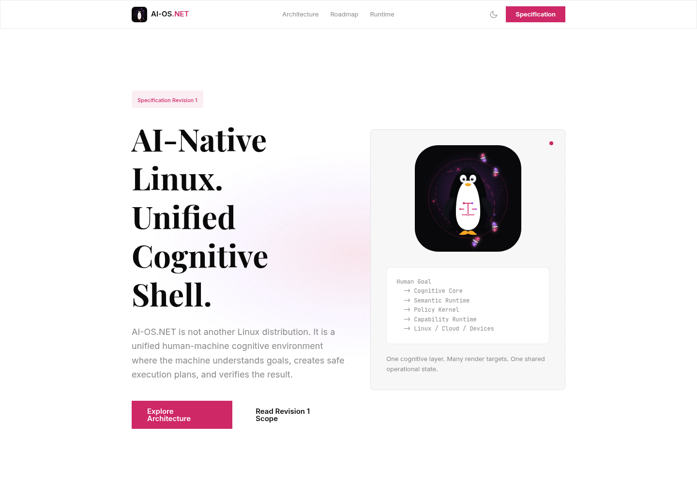

<p align="center"></p>

# worldcore · 语义世界 / Semantic World

> ★ **一个世界，说法只有一份。** / **One world, one vocabulary.**
>
> [中文](#中文) ｜ [English](#english)

---

# 中文

## 一、我们要干什么

**问题**：今天的操作系统只认「进程、文件、权限」。它不认「**谁**、**能干什么**、**干了什么**、**长什么样**」。
于是每接一个新东西（一个智能体、一个应用、一台机器），都要重新商量一遍"我们怎么说话"——**每接一次，谈一次**。

**目标**：把「说法」这一层单独做出来——

- 一个世界里，**说法只有一份**，谁接进来都按它说；
- 谁说了什么、谁允许的、发生在第几位，**记在一本账上**，事后查得到；
- **正式结论与签字只有人能下**，机器只出发现。

**不是又一个系统**，而是**所有系统都得照着说的那一层**：语义核（本体）＋ 一条唯一写路径 ＋ 一本只增不改的账。

## 二、核心原则

1. **本体只做四件事：认 · 盖章 · 转 · 记。** 本体自己不执行、不渲染、不碰机器。
2. **一个入口写。** 动作（action）是唯一的世界写通道；执行器必须持有**本体签发的凭证**（permit）才能动手，且凭证一号一用。
3. **一本账。** 只增不改：成功的、**被拒的**尝试都留痕；拒绝码是**闭集**（业务／身份／权限／输入／系统五类）。
4. **只有人能签。** 智能体只出发现清单，不代签、不代填结论。
5. **法是一份声明件。** 本体定义在 `src/ontology/world.json`（类／属性／接口／关系／动作语义／许可条文），
   代码只负责**解析 → 校验 → 装载**；**坏法装载即失败**，不是跑一半才发现。
6. **界面是协议，不是代码。** 提供者各自出画布（A2UI v1.0），个人空间负责摆放，呈现负责合成；
   渲染器是 Flutter ＋ `genui`（A2UI 官方渲染）。

## 三、现在的系统结构

### 3.1 运行时拓扑（7 个 systemd 单元，1 条总线）

```
        人（登录界面）／ 智能体 ／ 应用
                    │  都只说同一套话
                    ▼
   ★ 本体 aios-ontology —— 只做四件：认 · 盖章 · 转 · 记
                    │  world/exec（带 route ＋ 本体签发的凭证）
   ┌──────────┬─────┴──────┬──────────────┬───────────────┐
   ▼          ▼            ▼              ▼               ▼
计算机      呈现         个人空间        智能体         渲染半
(执行)     (合成)       (人的地盘)      (模型在环)      (Flutter＋genui)
   │          │
   └──── 全部经总线 zenoh（aios-bus）说话 ────┘
```

### 3.2 进程与职责

| 单元 | 角色 | 做什么 |
|---|---|---|
| `aios-bus` | 总线（zenohd，外部件） | 所有进程只通过它说话 |
| `aios-ontology` | **本体** | 认名／验票／验身份／判许可／跑前置条件／路由／发凭证／记账／查世界 |
| `aios-computer` | 计算机（执行器） | 验凭证 → 读映射表 → 调程序 → 回话；清除类必须写理由 |
| `aios-presentation` | 呈现（合成器） | 管"此刻屏上有什么"，出画／撤画／合成层 |
| `aios-presentation-render` | 渲染半 | Flutter ＋ genui，把 A2UI 帧画出来 |
| `aios-space` | 个人空间 | 人的地盘：登录后出桌面，摆放各提供者的画布 |
| `aios-agent` | 智能体 | 模型在环：问世界 → 决定 → 经本体做事 → 出帧 |

### 3.3 一次请求的路径（本体里的闸，顺序不许换）

```
world/ask
  → ① 名字在册？            拒绝码：UNKNOWN_ACTION
  → ①.5 参数齐/类型/取值？   拒绝码：PARAM_MISSING / PARAM_INVALID
  → ①.5b 票有效？           拒绝码：BAD_TICKET / TICKET_SCOPE_DENIED
  → ② 有身份？              拒绝码：NO_IDENTITY
  → ②.5 身份可核？（人凭票，其他凭报到）  拒绝码：HUMAN_NEEDS_TICKET / IDENTITY_NOT_REPORTED
  → ③ 许可条文放行？         拒绝码：PERMISSION_DENIED
  → ④ 前置条件成立？         拒绝码：PRECONDITION_FAILED / INTERFACE_NOT_IMPLEMENTED / PROVIDER_NOT_DECLARED
  → ⑤ 路由（绑接口按对象类型选执行者；否则按注册者）
  → ⑥ 发凭证 ＋ 转发 world/exec；结果回本体、记账、回请求方
```

**被拒也记账**：每次拒绝落一行（`kind_of=reject` ＋ 闭集码 ＋ 类别）。

### 3.4 总线话题

| 话题 | 方向 | 用途 |
|---|---|---|
| `world/ask` | → 本体 | 请求入口（只有本体订） |
| `world/ask/result` | → 请求方 | 拒绝原因 / 执行结果 |
| `world/exec` | 本体 → 执行者 | 转发动作（带 `route` 与 permit） |
| `world/register` | 提供者 → 本体 | 注册动作（谁启动谁注册） |
| `world/appear` | 提供者 → 本体 | 报到（成为个体；带 `reporter`，状态所有权） |
| `world/query` | 任意 → 本体 | 查世界／查动作／查历史 |
| `world/notice` | 提供者 → 本体 → 呈现 | 宣告（画布帧经本体） |
| `world/ui/act` | 呈现 → 个人空间 | 人在界面上的动作（点击等） |
| `world/ui/frame` | 本体 → 呈现 | 盖过章、写好收件人的画布信封 |

### 3.5 数据载体（一份事实一个载体）

| 载体 | 是什么 |
|---|---|
| `src/ontology/world.json` | **法**：本体声明件（唯一权威；人可审、可 diff） |
| `/var/lib/aios/ontology/ledger.jsonl` | **账**：只增不改；每行带时间戳 |
| `/var/lib/aios/ontology/objects.db` | **个体表**（SQLite）：报到过的个体与当前字段 |
| `/var/lib/aios/ontology/registry.jsonl` | **注册表**：哪些动作由哪个进程提供 |
| `/var/lib/aios/ontology/permits.jsonl` | **凭证账**：一号一用的凭证使用记录 |

### 3.6 本体规模（现取）

- **11 个类**（人／智能体／应用／服务／设备／工作流／账本／端口／空间／呈现／计算机）
- **4 个接口**（可标识／有状态／有主／可退休）＋ 运行时多态（`object.retire` 同一动作按对象类型选执行者）
- **5 条关系**、**22 个世界动作**（含参数、前置条件、效果、失败策略、许可条文）＋ **156 个命令动作**（系统命令映射）＝ **178 个在册动作**
- **9 个函数声明**（目前是占位：还没有函数运行时）
- 动作契约：参数校验、前置条件、效果清单、拒绝码、失败策略；账里带 `route`／`effects`

### 3.7 界面

- 登录：呈现出登录画布 → 认证走本体 → 拿票 → 凭票进个人空间 → 桌面画布；
- 画布：每个提供者出自己的一张（A2UI v1.0），个人空间按 `layout.layers`（层 z＋矩形 rect）摆放；
- 呈现按票过滤：谁的票看谁的画布（甲登录看不到乙的）；
- 桌面：**图标网格**（智能体／这台机器／能做什么／退出）——四个都接通、都用真实鼠标点击验过：智能体＝经本体开 agent 窗口；这台机器＝经本体查 `sys.GetHostState` 出窗口；能做什么＝`world/query kind=actions` 出窗口；退出＝销票（经本体）→ 回登录画布；
- 窗口：统一窗口壳（标题栏＋右上角「缩放／关闭」）；关闭＝经本体 `presentation.retract_surface`（带理由）撤画布；
- 多窗口：每个应用一张 surface，由个人空间按 `layout.layers` 摆位（地基已有，第二个应用待接）。

### 3.8 仓库目录（实际在跑的）

```
src/                     语义面（Python）
  ontology/              本体：world.json（法）＋ 装载/校验 ＋ 认·盖章·转·记
  presentation/          呈现：合成器 ＋ 窗口壳 ＋ 登录帧 ＋ A2UI 校验 ＋ 渲染半（Flutter）
  space/                 个人空间：桌面 ＋ 布局
  computer/              计算机：执行器（命令映射表）
  agent/                 智能体：模型在环
  foundry_ontology/      对象模型库（上游件，见 src/NOTICE.md）
  legacy/                旧代码归档（不部署）
scripts/
  release/               幂等部署链 ＋ 生成物（ontology.json／手册／OWL）
  test/                  判据（开发面；按作者令不随仓发布）
ninedim/                 工程档案：书／策划／需求／设计／规格／变更盒
site/                    项目站点
.github/                 协作模板
```

> 注：仓库根的 `Cargo.toml` 指向上游 AIOS 的 Rust workspace（`crates/…`，本副本未携带）；
> **本仓当前实际运行的是 `src/` 语义面 ＋ `scripts/release/` 部署链**。

## 四、验证与现状

**判据 66 条，全部会红**（每条自带反例自检）。按作者令，判据在**开发面**运行、不随仓发布；
这里只报结论：

```
python scripts/test/check.py              → 全绿（38/38，rc=0）
python scripts/test/check.py --self-test  → 全绿（反例会红、恢复会绿）
```

**已验证（代表）**：

| 组 | 验过什么 |
|---|---|
| 认证与身份 | 密码错拒／对则发票；票过期、销票后拒；甲票查不到乙；人凭票、其他凭报到，没报到拒 |
| 许可与凭证 | 凭证绑动作＋参数、有期限、**一号一用**；执行器没凭证拒、重放拒；一号一用的账在本体 |
| 审计与拒绝码 | 拒绝码闭集（业务/身份/权限/输入/系统）；成功与被拒两侧都留痕；查历史过本体 |
| 定义与动作语义 | 法在 `world.json`（坏法装载即失败）；参数先校验；前置条件转发前真跑；效果进账 |
| 结构与多态 | 4 个接口；`object.retire` 按对象类型路由到不同执行者；状态所有权（冒充代报拒） |
| 人确认/委托（提案） | 「四格」委托：范围/期限/次数/可撤，是本体的对象而非提示词；Agent 不能自签、不能替人点确认；**法改动待作者签**（`提案-人确认与委托四格-待裁-2026-10-20.md`） |
| 记忆系统（提案） | 记忆＝**世界里的对象**（记忆/关系/动作/账），不是向量库当真相；写经本体、读按 owner/空间；**法草案**在 `src/ontology/proposals/memory.proposal.json`（`law_proposal.py --check` 机器验同构，**待作者签**）；说明见 `ninedim/…/提案-记忆系统-按本体理念-待裁-2026-10-20.md` |
| 场景文件化（P3） | 空间每次出画布都落成 `/var/lib/aios/scenes/<surface>.json`（surface/at/frame，A2UI 帧原样）；人能读、能 diff、能备份；浏览器 `/scenes`、`/scene?surface=…` 可查看；判据 C55 |
| Agent 进程可观测（P7） | agent 每轮/每事件写 `/run/aios/agent-heartbeat.json`（pid/name/last_at/events/round）；浏览器桥 `/agent` 读心跳并显示「几秒前」；判据 C54 |
| A2UI 跟版（P5） | `scripts/release/a2ui_conformance.py`：源码/动态帧用到的组件必须在 basic catalog 内，且 **Web 渲染器都有 case**（判据 C53） |
| 语义浏览器断线补漏 | SSE 事件带 `id:`；EventSource 重连带 `Last-Event-ID` ⇒ 桥用 events `since` 补齐错过的事件（P8 在浏览器上落地） |
| 终报生成（06:00） | `scripts/release/dsh/goal/final_report.py`：DONE/三条 timer 现取＋一屏状态＋最近轮报告＋已知缺口，一条命令写终报；判据 C58 |
| 一屏状态（交接用） | `scripts/release/status.py`：一条命令看快照/进度/轮次摘要/游标/场景/世界文件/guard/单元（`--json` 机读）；判据 C57 |
| 语义浏览器 | `src/web/` 进程：HTTP 页面＋SSE 推 A2UI 帧＋POST 命令（登录/点按钮）；页面用 **Web Speech** 听/说，不依赖 Flutter，不绕过本体；**有确认弹窗（允许一次/允许并委托/拒绝，签回本体）**；支持 `?user=..&secret=..` 自动登录与 `/render` 服务端静态预览（截图/kiosk） |
| 权限执行（guard-exec） | `src/guard/guard_exec.py`：用 **Landlock**（内核 LSM，用户态可用的接口）给子进程限文件访问；`--dry-run` 看计划、`--apply` 真套；越界写被内核拒 |
| 人确认弹窗（语义浏览器） | 本体发 `confirm.request` → 推送 `world/notice` → 语义浏览器弹窗（允许一次/允许并委托/拒绝）→ 人点 ⇒ 带票 `world/ask confirm.resolve`；判据 C60 |
| 确认/委托/审计（治理） | 法里有 `delegation`/`confirmation`/`policy` 三类＋8 动作；`governance.py` 本地执行：人能签、agent 不能签/自签；`audit.record` 带 HMAC 才回账（写 `kind_of=security`）；判据 C59 |
| **值变了才上报** | computer 采集每 10 秒一次，但**只有值真的变了才 `world/appear`**（负载 >0.1／可用内存 ≥64MB／其余属性不等；uptime 不参与判定）；300 秒心跳兜底证明还活着；判据 C66 |
| **computer 实时数据管道** | computer 每 **10 秒**采集底层事实（uptime/load/mem/cpu/os）并 `world/appear` 上报本体 ⇒ 本体更新个体＋落账＋推事件；本体窗口「机器」页自动刷新；判据 C65 |
| **语义浏览（不是桌面镜像）** | 浏览器右侧是「语义浏览」：地址栏 `world://overview|actions|events|history` ＋ 世界数据（概览/动作/事件/账）；A2UI 帧不再自动渲染成桌面（调试区手动加载）；判据 C64 |
| **桌面语义浏览器图标** | 桌面帧里有「🌐 语义浏览器」图标；点它 ⇒ 空间以人身份带票发 `world/ask app.open_url`（url=语义浏览器地址）⇒ 计算机起浏览器窗口（出向只许计算机）；判据 C63 |
| **桌面确认弹窗** | 本体推 `confirm.request` ⇒ 个人空间在**桌面**出「guard 确认」窗口（三按钮：拒绝/允许一次/允许并委托）；人点按钮 ⇒ 桌面以**带票** `world/ask confirm.resolve` 回本体；判据 C62 |
| **guard 弹窗** | 变更类动作（如 `sys.AptInstall`）由 agent 请求 ⇒ guard 判 `decision=confirm` ⇒ 本体回 `CONFIRM_REQUIRED` 并推 `confirm.request` ⇒ 语义浏览器弹窗；人签的委托（四格）放行并 `used+1`，用尽/过期再要确认；判据 C61 |
| 权限进程（guard） | **单独进程**：Unix socket `/run/aios/guard.sock` 回「谁能不能做某动作」（与本体 can_execute 同口径）；`src/guard/guardctl.py` 是命令行客户端；执行（Landlock/AppArmor/eBPF）留给 guard-exec |
| 世界＝文件（P3） | `scripts/release/worldfs.py`：账**只读**导出成 `events/<日期>/<小时>.jsonl`＋`INDEX.md`（人可 grep、脚本可查）；只导公开字段，params/票/body 绝不导出；systemd 每 15 分钟 |
| 长程闭环评估（P6） | `scripts/release/dsh/goal/round_eval.py`：把每轮报告/提交扫成 `rounds.jsonl`（证据/回滚/提交/缺报告都能数）；systemd 每 15 分钟 |
| 世界分叉/时间线（P4） | `world_snapshot.py fork --snap DIR --name X` 拷出一个平行世界（`fork.json` 记 parent，不改原件）；`timeline` 列快照＋分叉 |
| 世界快照（P4） | `scripts/release/world_snapshot.py`：账＋注册表＋对象库＋法源打包成快照；`verify` 验、`restore --yes` 回滚（先备份）；`prune --keep 24`；**每小时定时快照**；不含票/密码 |
| P8 事件回放 | `world/query kind=events`：从账里回放最近事件（按身份/空间过滤，只公开字段）——掉线后可补看 |
| P8 事件流 | 本体账落完即推 `world/event`（只公开字段）；空间按空间过滤并实时重画「活动」窗口；Agent 订阅事件进规划上下文（activity）；**登录/启动时回放最近事件（掉线补推），带游标 `since` 精确续传** |
| 看门狗＋限时目标 | 看门狗每 3 分钟：7 单元／本体可装起／资源线／定时器失败即停；目标链每 30 分钟一轮（高权限、快照、验收红回滚），**06:00 Asia/Shanghai 到点强制停链** |
| DSH（VM） | 已装 **0.2.1-rc.2**（npm `latest` 同版）；headless 经本体问出 22 个注册动作；evolve 能改 `world.json`＋`export-law --check`＋还原；**每 6 小时一轮进化提案**（只提案、不落法、不推） |
| 账的读闸 | **秘密不落账**（票/密码脱敏）＋**匿名查历史拒**＋**人只看自己空间、Agent 只看自己＋当前空间**（跨空间授权未做） |
| 界面/桌面状态动作 | 提供者**注册时就预留** `presentation.state`／`space.state`；问一次回全（surfaces/layout/screen/actives；user/state/guests/own）；Agent 用它看屏 |
| 界面 | 不合 A2UI 目录整帧拒；撤画布必须写理由；多画布由空间摆位；按票过滤；**桌面图标网格＋五个图标真实点击都经本体（本体/开窗/查机器/查动作/退出）＋窗口缩放/关闭＋亮色主题与壁纸**；**Agent 经本体问界面（presentation.list_surfaces 连布局一起返回）——不靠截图** |

**还没做（如实）**：

| 没做 | 为什么 |
|---|---|
| 人确认（变更类动作默认拒） | "谁批／怎么批／批了记哪／管多久"四格未定 |
| 总线 ACL（谁能发/收哪个话题） | 总线只听本机，但登录本机的人可发任意话题；需给进程身份后再配规则 |
| 事务 / 回滚 / 补偿 | 效果目前是声明＋记账；外部副作用不可逆，回滚要逐个动作裁 |
| **真·按需起进程**（窗口已能由点击打开，进程仍常驻） | 进程生命周期要改部署（agent 不再开机自启）＋关窗是否停进程要定；先做「窗口起来」 |
| 窗口拖拽/自由缩放；多窗口同时打开 | 缩放＝最大化/还原；两个窗口同时开着还没专门验 |
| **状态实时推送**（现在读状态是"拉取"：问一次答一次） | 事件驱动＋双向推送（`world.event`）还没做；界面靠帧更新重画已有地基 |
| DSH 的 GUI 入口 | 作者吩咐先不做界面；现在只有 headless／evolve 两条命令行 |
| MCP 工具面 / 函数运行时 | 手册已从本体派生；MCP server 与只读函数执行器未做 |
| 对象级版本链 | 今天只有事件史（账）；个体更新/撤下的写路径未齐 |
| **跨空间授权**（读别人空间的账/看别人屏） | 读闸已按「自己／自己空间」过滤；跨空间要额外授权（谁授/范围/时限/可撤）还没定 |
| 多人在线 / 大对象货运道 | 单用户空间；数据面暂不需要 |

## 五、怎么跑

```sh
git clone <this repo>
cd <this repo>
sudo REPO=. bash scripts/release/deploy.sh    # 幂等：拷代码 ＋ 装单元 ＋ 恢复 SELinux ＋ 重启 7 个单元
```

目标机：openSUSE Leap 16 / systemd / python3 / zenohd / Flutter（渲染半）。
生成物（都是构建产物，改输入后重跑）：

```sh
python3 scripts/release/export-ontology.py      # 本体 → JSON
python3 scripts/release/make-manual.py          # 本体 → 应用手册（json＋md）
python3 scripts/release/export-owl.py           # 本体 → OWL Turtle ＋ SHACL（单向）
python3 scripts/release/export-law.py --check   # 声明件 ≡ 运行中的法
```

## 六、来源与许可

- 许可：见 [LICENSE](LICENSE)。
- 对象模型库：取自 `foundry-ontology-open`（MIT），改动逐笔登记在 [src/NOTICE.md](src/NOTICE.md)。
- 上游：AI-OS（Apache-2.0，其 Rust workspace 不在本副本内）。
- 设计参考（只借形状、不借代码）：三个开源本体实现（订单型本体平台／借书平台骨架／教学版本体）。
- 工程档案：[ninedim/](ninedim/)。

---

# English

## 1. What we are building

**Problem.** Today's operating systems only recognize *processes, files and permissions*. They do not recognize
**who** did something, **what** they were allowed to do, **what happened**, or **what it looked like**.
Every time a new thing is wired in (an agent, an app, a machine), the same conversation starts over: *"how do we talk to each other?"*

**Goal.** Build the *vocabulary layer* as a first-class thing:

- **one world, one vocabulary** — everything that plugs in speaks it;
- **who said what, who allowed it, and its position in the log** — recorded in one append-only ledger, queryable afterwards;
- **only humans sign** — machines produce findings, never verdicts.

This is **not yet another system**: it is the layer every system has to speak — a semantic core (ontology),
one single write path, and one append-only ledger.

## 2. Principles

1. **The ontology does exactly four things: recognize · stamp · forward · record.** It never executes, renders or touches the machine.
2. **One write path.** Actions are the only way to change the world; an executor must hold a **permit issued by the ontology**, and each permit is single-use.
3. **One ledger.** Append-only: successes **and refusals** are recorded; refusal codes are a **closed set** (business / identity / permission / input / system).
4. **Only humans sign.** Agents produce findings; they never sign or fill in verdicts.
5. **The law is a declarative file.** The ontology is defined in `src/ontology/world.json` (classes / properties / interfaces / links / action semantics / grants);
   code only parses, **validates** and loads it. **An invalid law fails at load time**, not halfway through a request.
6. **The UI is a protocol, not code.** Each provider draws its own surface (A2UI v1.0), the personal space places it,
   presentation composes it; the renderer is Flutter + `genui` (the official A2UI renderer).

## 3. Current system structure

### 3.1 Runtime topology (7 systemd units, 1 bus)

```
        human (login UI) / agent / apps
                    │  all speak the same vocabulary
                    ▼
   ★ ontology (aios-ontology) — recognize · stamp · forward · record
                    │  world/exec (route + ontology-signed permit)
   ┌──────────┬─────┴──────┬──────────────┬───────────────┐
   ▼          ▼            ▼              ▼               ▼
computer  presentation  personal space  agent          renderer
(execute) (compose)     (human's space) (model-in-loop) (Flutter + genui)
   │          │
   └──── everything talks over the zenoh bus (aios-bus) ────┘
```

### 3.2 Units and responsibilities

| Unit | Role | What it does |
|---|---|---|
| `aios-bus` | bus (zenohd, external) | the only channel between processes |
| `aios-ontology` | **ontology** | recognize / verify ticket / verify identity / authorize / run preconditions / route / issue permit / record / query |
| `aios-computer` | computer (executor) | verify permit → read command map → run program → reply; removals must carry a reason |
| `aios-presentation` | presentation (composer) | keeps "what is on screen now"; shows/retracts surfaces; composes layers |
| `aios-presentation-render` | renderer half | Flutter + genui; renders A2UI frames |
| `aios-space` | personal space | human's desktop; places surfaces from providers |
| `aios-agent` | agent | model-in-the-loop: query world → decide → act through ontology → draw frames |

### 3.3 The path of one request (gate order is fixed)

```
world/ask
  → ① is the name registered?          UNKNOWN_ACTION
  → ①.5 are parameters valid?          PARAM_MISSING / PARAM_INVALID
  → ①.5b is the ticket valid?          BAD_TICKET / TICKET_SCOPE_DENIED
  → ② is there an identity?            NO_IDENTITY
  → ②.5 is the identity verifiable?    HUMAN_NEEDS_TICKET / IDENTITY_NOT_REPORTED
  → ③ do the grants allow it?          PERMISSION_DENIED
  → ④ do preconditions hold?           PRECONDITION_FAILED / INTERFACE_NOT_IMPLEMENTED / PROVIDER_NOT_DECLARED
  → ⑤ routing (interface-based: pick executor by object type; else by registrant)
  → ⑥ issue permit + forward to world/exec; result returns here, recorded, returned to caller
```

**Refusals are recorded too**: every rejection writes a row (`kind_of=reject` + closed-set code + category).

### 3.4 Bus topics

| Topic | Direction | Purpose |
|---|---|---|
| `world/ask` | → ontology | request entry (only the ontology subscribes) |
| `world/ask/result` | → caller | refusal reason / execution result |
| `world/exec` | ontology → executor | forwarded action (with `route` and permit) |
| `world/register` | provider → ontology | register actions (whoever starts, registers) |
| `world/appear` | provider → ontology | report-in (become an individual; carries `reporter`, i.e. state ownership) |
| `world/query` | any → ontology | query world / actions / history |
| `world/notice` | provider → ontology → presentation | announcement (frames go through the ontology) |
| `world/ui/act` | presentation → personal space | human UI actions (clicks, etc.) |
| `world/ui/frame` | ontology → presentation | stamped envelope with `to` (who may see it) |

### 3.5 Data carriers (one fact, one carrier)

| Carrier | What it is |
|---|---|
| `src/ontology/world.json` | **the law**: declarative ontology (single source of truth; reviewable, diffable) |
| `/var/lib/aios/ontology/ledger.jsonl` | **the ledger**: append-only; each row timestamped |
| `/var/lib/aios/ontology/objects.db` | **individuals** (SQLite): reported individuals and their current fields |
| `/var/lib/aios/ontology/registry.jsonl` | **registry**: which action is provided by which process |
| `/var/lib/aios/ontology/permits.jsonl` | **permit ledger**: single-use accounting of issued permits |

### 3.6 Ontology scale (current)

- **11 classes** (human / agent / application / service / device / workflow / ledger / port / space / presentation / computer)
- **4 interfaces** (Identifiable / Stateful / Owned / Retirable) + runtime polymorphism (`object.retire` routes by object type)
- **5 links**, **22 world actions** (parameters, preconditions, effects, failure policy, grants) + **156 command actions** (system command map) = **178 registered actions**
- **9 function declarations** (placeholder: no function runtime yet)
- Action contract: parameter validation, preconditions, effect list, refusal codes, failure policy; ledger rows carry `route` / `effects`

### 3.7 UI

- Login: presentation draws the login canvas → authentication goes through the ontology → ticket → personal space → desktop canvas;
- Surfaces: each provider draws its own (A2UI v1.0); the personal space places them via `layout.layers` (z-order + rect);
- Presentation filters by ticket: you only see the surfaces your ticket allows;
- Desktop: **icon grid** (agent / this machine / capabilities / logout) — all four are wired and verified with **real mouse clicks**: agent → window through the ontology; this machine → `sys.GetHostState` through the ontology; capabilities → `world/query kind=actions`; logout → revoke ticket (through the ontology) → back to the login canvas;
- Windows: one shared window shell (title bar + zoom/close at the top right); close = `presentation.retract_surface` through the ontology (with a reason);
- Multi-window: each app is one surface, placed by the personal space via `layout.layers` (foundation in place; second app pending).

### 3.8 Repository layout (what actually runs today)

```
src/                     semantic plane (Python)
  ontology/              ontology: world.json (the law) + loader/validator + recognize/stamp/forward/record
  presentation/          presentation: composer + window shell + login frame + A2UI validation + renderer half (Flutter)
  space/                 personal space: desktop + layout
  computer/              computer: executor (command map)
  agent/                 agent: model-in-the-loop
  foundry_ontology/      object model library (upstream; see src/NOTICE.md)
  legacy/                archived old code (not deployed)
scripts/
  release/               idempotent deploy chain + generated artifacts (ontology.json / manual / OWL)
  test/                  criteria (dev-only; per the author's decision, not shipped in this repo)
ninedim/                 engineering docs: book / planning / requirements / design / spec / change box
site/                    project site
.github/                 collaboration templates
```

> Note: the root `Cargo.toml` points at the upstream AIOS Rust workspace (`crates/…`, not carried in this copy).
> **What actually runs in this repository is the `src/` semantic plane + the `scripts/release/` deploy chain.**

## 4. Verification and status

**66 criteria, each able to fail** (every criterion ships with a self-test that proves it turns red).
Per the author's decision they run on the **development side** and are not shipped here; only the conclusion is reported:

```
python scripts/test/check.py              → all green (66/66, rc=0)
python scripts/test/check.py --self-test  → all green (red examples turn red, restored turn green)
```

**Verified (highlights)**:

| Area | What was verified |
|---|---|
| Authentication & identity | wrong password refused / correct issues a ticket; expired & revoked tickets refused; Alice's ticket cannot read Bob's space; humans need tickets, others need to have reported in |
| Authorization & permits | permits bind action + params, expire, are **single-use**; executors without a permit refuse; replay refused; single-use accounting lives in the ontology |
| Audit & refusal codes | closed refusal-code set (business / identity / permission / input / system); successes **and** refusals recorded; history query goes through the ontology |
| Definition & action semantics | the law lives in `world.json` (invalid law fails at load); parameters validated before forwarding; preconditions run before forwarding; effects recorded |
| Structure & polymorphism | 4 interfaces; `object.retire` routes by object type to different executors; state ownership (spoofed reports refused) |
| Human confirmation / delegation (proposal) | "Four-box" delegation: scope / expiry / max uses / revocable, a first-class world object rather than prompt text; agents can neither self-grant nor click confirm on behalf of humans; **law change awaits the author's signature** |
| Memory system (proposal) | memory = **first-class world objects** (objects/relations/actions/ledger), not a vector DB as truth; written through the ontology, read scoped by owner/space; a **law draft** lives in `src/ontology/proposals/memory.proposal.json` (`law_proposal.py --check` verifies structural fit; **awaits the author's signature**) |
| Scenes as files (P3) | every canvas draw is saved as `/var/lib/aios/scenes/<surface>.json` (surface/at/frame, the A2UI frame verbatim); human-readable, diff-able, backup-able; viewable via the browser `/scenes` and `/scene?surface=…`; criterion C55 |
| Agent process observability (P7) | the agent writes `/run/aios/agent-heartbeat.json` every round/event (pid/name/last_at/events/round); the web bridge `/agent` reads it and shows “seconds ago”; criterion C54 |
| A2UI version conformance (P5) | `scripts/release/a2ui_conformance.py`: every component used in sources/generated frames must be in the basic catalog **and have a case in the Web renderer** (criterion C53) |
| Semantic browser catch-up | SSE events carry `id:`; on reconnect EventSource sends `Last-Event-ID` ⇒ the bridge backfills missed events via events `since` (P8 in the browser) |
| Final report (06:00) | `scripts/release/dsh/goal/final_report.py`: DONE / three DSH timers live state + one-screen status + recent reports + known gaps, one command writes the final report; criterion C58 |
| One-screen status (handoff) | `scripts/release/status.py`: snapshots/progress/rounds/cursors/scenes/world-files/guard/units in one command (`--json` for machines); criterion C57 |
| Semantic browser | `src/web/` process: HTTP page + SSE pushing A2UI frames + POST commands (login/clicks); the page uses **Web Speech** to listen/speak, no Flutter, never bypasses the ontology; **confirmation modal (allow once / allow + delegate / deny, signed back through the ontology)**; supports `?user=..&secret=..` auto-login and a server-side `/render` static preview |
| Permission enforcement (guard-exec) | `src/guard/guard_exec.py`: applies **Landlock** (an LSM usable from userspace) to confine a child process's file access; `--dry-run` shows the plan, `--apply` enforces; out-of-policy writes are rejected by the kernel |
| Confirmation / delegation / audit (governance) | law has `delegation`/`confirmation`/`policy` classes + 8 actions; `governance.py` executes locally: only humans sign, agents cannot sign or self-grant; `audit.record` requires HMAC before it is written back as a `kind_of=security` row; criterion C59 |
| Permission process (guard) | a **separate process**: Unix socket `/run/aios/guard.sock` answers “may this actor do this action?” (same rule as ontology `can_execute`); `src/guard/guardctl.py` is the CLI client; enforcement (Landlock/AppArmor/eBPF) is left to guard-exec |
| World as files (P3) | `scripts/release/worldfs.py`: read-only export of the ledger into `events/<date>/<hour>.jsonl` + `INDEX.md` (greppable, queryable); public fields only — never params/tickets/body; systemd every 15 min |
| Long-horizon loop eval (P6) | `scripts/release/dsh/goal/round_eval.py`: turns each round's report/commit into `rounds.jsonl` (evidence / rollback / commit / missing reports are countable); systemd every 15 min |
| World fork/timeline (P4) | `world_snapshot.py fork --snap DIR --name X` copies a snapshot into a parallel world (`fork.json` records the parent; original untouched); `timeline` lists snapshots + forks |
| World snapshot (P4) | `scripts/release/world_snapshot.py`: packs ledger + registry + object store + law into a snapshot; `verify` checks it, `restore --yes` rolls back (with pre-restore backups); `prune --keep 24`; **hourly timer**; no tickets/passwords |
| P8 event replay | `world/query kind=events`: replays recent events from the ledger (identity/space filtered, public fields only) — recovery after a dropped connection |
| P8 event stream | the ontology pushes `world/event` after each ledger row (public fields only); the space filters by space and live-redraws the “activity” window; the agent subscribes and feeds events into its planning context; **recent events are replayed on login/startup (offline catch-up) with a `since` cursor** |
| Watchdog + timed goal | watchdog every 3 min: 7 units / ontology loads / resources / timers; goal chain every 30 min (high privilege, snapshot, rollback on red), **hard stop at 06:00 Asia/Shanghai** |
| DSH (VM) | installed **0.2.1-rc.2** (same as npm `latest`); headless asks the ontology and gets 22 registered actions; evolve can edit `world.json` + `export-law --check` + revert; **an evolution proposal every 6 hours** (proposal only, never signs, never pushes) |
| Ledger read gate | **no secrets in the ledger** (tickets/passwords redacted) + **anonymous history refused** + **humans see only their space, agents see themselves + the current space** (cross-space grants not done yet) |
| UI/desktop state actions | providers reserve `presentation.state` / `space.state` **at registration time**; one call returns everything (surfaces/layout/screen/actives; user/state/guests/own); the agent uses it to see the screen |
| UI | frames violating the A2UI catalog are rejected as a whole; retraction requires a reason; multiple surfaces placed by the space; ticket-based filtering; **desktop icon grid; five icons verified with real clicks and go through the ontology (ontology overview / open window / query machine / query actions / logout); window zoom/close; light theme + wallpaper**; **agent asks the interface through the ontology (`presentation.list_surfaces` returns layout too) — no screenshots required** |

**Not done yet (honest list)**:

| Not done | Why |
|---|---|
| Human approval (change-type actions are denied by default) | the four boxes — who approves / how / where recorded / for how long — are undefined |
| Bus ACL (who may publish/subscribe to which topic) | the bus listens on localhost, but anyone logged into the machine can publish anywhere; needs per-process identity first |
| Transactions / rollback / compensation | effects are declared and recorded today; external side effects are irreversible, rollback must be decided per action |
| **On-demand process start** (windows open on click; processes are still resident) | process lifecycle needs deployment changes (agent no longer auto-starts) and a decision on whether closing stops the process |
| Window dragging / free resize; several windows open at once | zoom = maximize/restore; simultaneously-open windows not specifically verified yet |
| **Real-time state push** (state reads are pull-based today) | event-driven two-way push (`world.event`) is not done; frame-update repaint foundation already exists |
| DSH GUI entry | the author asked to skip the GUI for now; only the headless / evolve CLIs exist |
| MCP tool surface / function runtime | the manual is generated from the ontology; the MCP server and a read-only function executor do not exist yet |
| Object-level version chains | only the event history (ledger) exists; update/retract write paths are not complete |
| **Cross-space grants** (read another space's ledger/screen) | the read gate already filters by “self / own space”; the extra cross-space grant (who, scope, TTL, revocable) is not designed yet |
| Multi-user sessions / large-object data plane | single-user space; not needed yet |

## 5. How to run

```sh
git clone <this repo>
cd <this repo>
sudo REPO=. bash scripts/release/deploy.sh    # idempotent: copy code, install units, restore SELinux, restart the 7 units
```

Target machine: openSUSE Leap 16 / systemd / python3 / zenohd / Flutter (renderer half).
Generated artifacts (build products; re-run generators after changing inputs):

```sh
python3 scripts/release/export-ontology.py      # ontology → JSON
python3 scripts/release/make-manual.py          # ontology → application manual (json + md)
python3 scripts/release/export-owl.py           # ontology → OWL Turtle + SHACL (one-way export)
python3 scripts/release/export-law.py --check   # declarative law ≡ running law
```

## 6. Provenance and license

- License: see [LICENSE](LICENSE).
- Object model library: from `foundry-ontology-open` (MIT); every change is registered in [src/NOTICE.md](src/NOTICE.md).
- Upstream: AI-OS (Apache-2.0; its Rust workspace is not carried in this copy).
- Design references (shape, not code): three open-source ontology implementations (an order-driven ontology platform, a library-platform skeleton, a teaching-grade ontology).
- Engineering docs: [ninedim/](ninedim/).
