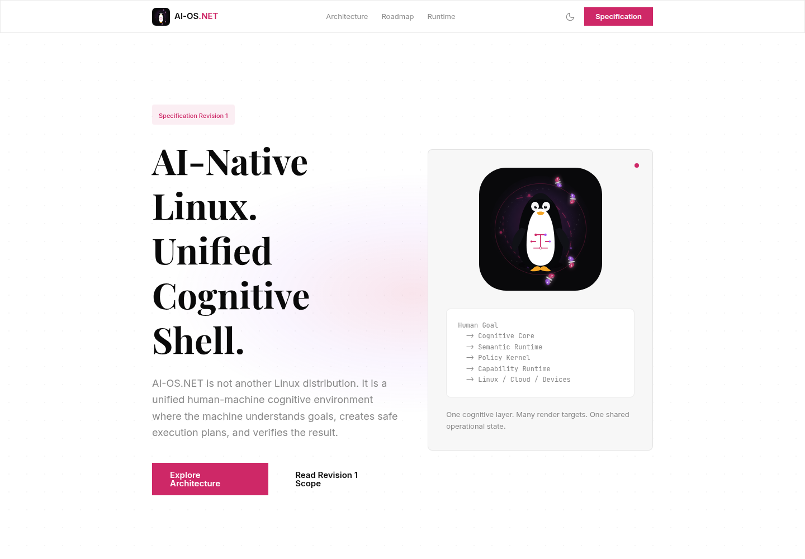

# worldcore · 语义世界

> **一个世界，说法只有一份。**

---

## 我们看见的

今天的计算机只认「进程、文件、权限」。

它不认「**谁**、**能干什么**、**干了什么**、**长什么样**」。

于是每接一个新东西——一个智能体、一个应用、一台机器——都要重新谈一遍「我们怎么说话」。

**每接一次，谈一次。**

## 我们相信的

- **说法，应该是世界里最基础的东西**，而不是每次连接时临时谈出来的。
- **一个世界，说法只有一份。** 谁接进来，都按它说。
- **一件被写下来的事，要能回答七个问题**：谁做的 · 对什么做的 · 从什么变成什么 · 因为什么才发生 · 排在第几位 · 谁允许的 · 什么单位。
- **说法要能被别人自己核一遍。** 我们不要任何人先相信我们。
- **裁决不在模型里，在记录里。** 模型可以提议；正式结论与签字只有人能下。
- **它不「懂」意思，只把「意思的形式」固定下来。** 理解仍在各方。
- **它在所有参与者之下**：谁都可以依赖它，它不依赖任何参与者。

## 我们想要的世界

- 每个进来的人、每个智能体、每个应用、每台机器，说的是同一种话；
- 发生过的每件事，都留下一条能被复查的记录——**被拒绝的也留下**；
- 换掉底层：换机器、换模型、换界面，**说法不变**。

## 为什么值得

不是因为它是「又一个系统」。

而是因为今天**每一种连接都要重新谈判**，而这份成本由每个人、每个团队、每次接入承担。
把「说法」这一层单独做出来，连接就不再从零开始。

---

> **我们不要任何人先相信我们。**
> **我们只要求：等你看到那条记录时，你能自己去核。**

---

许可见 [LICENSE](LICENSE)。
