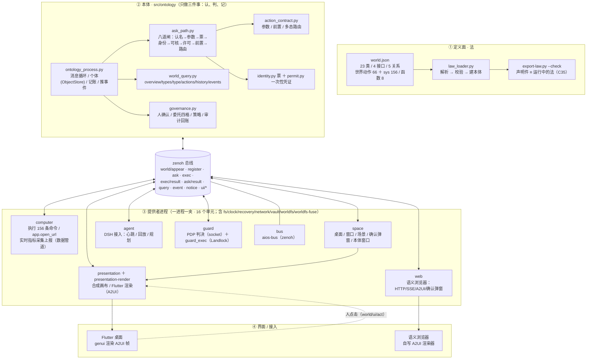
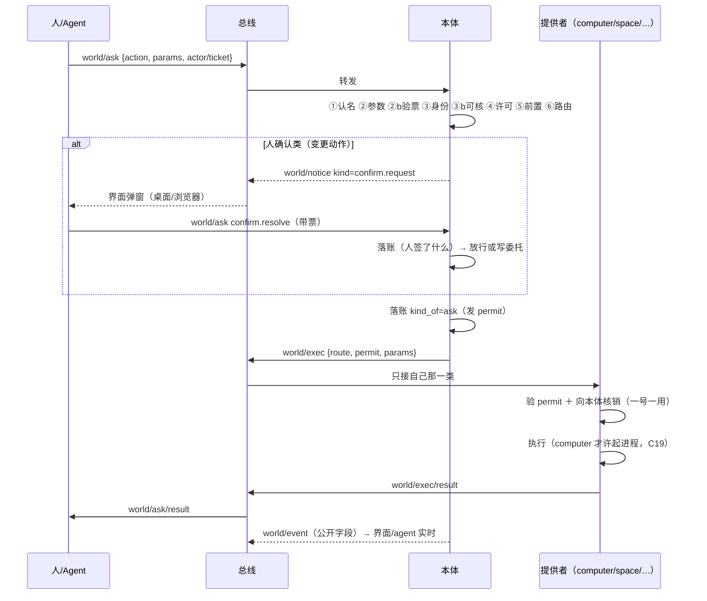
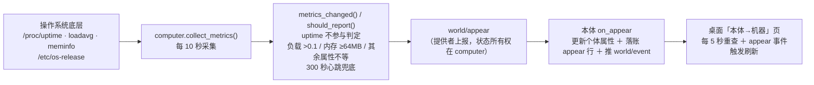
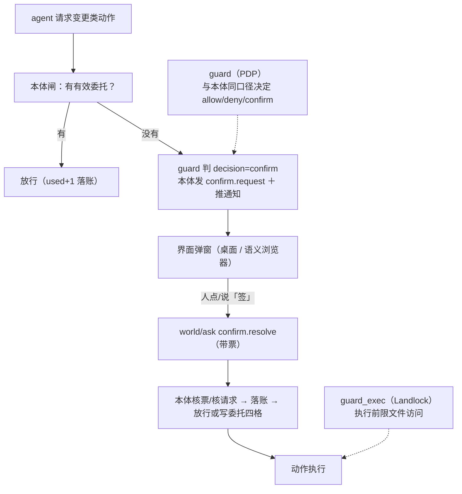

# worldcore 架构图（总览）

> 现取：2026-10-20（二期收口）。类 27 ／ 接口 4 ／ 关系 5 ／ 在册动作 222（sys 156 ＋ 世界 66）／ 函数 8 ／ 判据 90 条 ／ 常驻单元 16 个。
> 图里所有进程都是独立 systemd 单元；所有消息走 zenoh 总线话题 `world/*`。

## 一、四层总览



## 二、代码分夹（本体）

```
src/ontology/
├─ ontology_process.py      入口：消息循环 / 个体 / 账 / 事件
├─ world.json               法（唯一权威；保持根）
├─ law/                     law_loader / law_dump / ontology_definition / sysknife_actions / grants
├─ gate/                    ask_path / action_contract / identity / permit / world_codes
├─ query/                   world_query
├─ ingest/                 数据管道（接收 world/appear → 校验 → 建/更新个体 → 落账）
├─ govern/                  governance（确认/委托/策略/审计）
└─ proposals/               法草案（智能体只出草案，人能签）
```

## 三、数据面（东西存在哪）

| 面 | 路径 | 谁的权威 |
|---|---|---|
| 法（定义） | `src/ontology/world.json` | 唯一权威；`export-law --check` 对账 |
| 个体（A 盒） | `/var/lib/aios/ontology/objects.db`（SQLite） | 本体 ObjectStore |
| 证据（账） | `/var/lib/aios/ontology/ledger.jsonl`（只追加） | 本体（唯一一支笔） |
| 注册表 | `/var/lib/aios/ontology/registry.jsonl` | 提供者注册的动作 |
| 一次性凭证 | `/var/lib/aios/ontology/permits.jsonl` | 本体签发/核销 |
| 事件回放 / 界面 | `/var/lib/aios/{cursors,scenes}` | 空间/浏览器游标、场景文件 |
| 世界文件 | `/var/lib/aios/world/`（worldfs 导出） | 账→文件树的只读镜像 |
| 快照 | `/var/backups/aios/world-snapshots/`（含 forks） | 定时快照进程 |

## 四、一条 `world/ask` 怎么走（八道闸）



## 五、实时数据管道（computer → 本体 → 界面）



## 六、权限 / 人确认 / guard



## 七、运行面（systemd 单元与数据流）

| 单元 | 作用 |
|---|---|
| `aios-bus` | zenoh 总线（7447） |
| `aios-ontology` | 本体：闸/账/事件/查询 |
| `aios-computer` | 执行器＋系统事实上报 |
| `aios-presentation` | 画布合成（A2UI） |
| `aios-presentation-render` | Flutter/genui 渲染器 |
| `aios-space` | 个人空间（桌面/窗口/场景/确认/本体窗口） |
| `aios-agent` | DSH 智能体接入 |
| `aios-guard` | 权限决定（socket `/run/aios/guard.sock`） |
| `aios-web` | 语义浏览器桥（8765） |

> 定时器：看门狗（3 分钟）、世界快照（每小时）、worldfs（15 分钟）等（不属于 9 个常驻进程）。

## 七半、二期底层进程（fs／clock）

- `src/fs/`：语义文件只读服务（`file.stat/list/hash/read_text`＋`fs.state`）；报到/注册/订 ask/验 permit/回账；读到的文件报成 `file` 个体。
- v1 **只读**：白名单根（`/var/lib/aios:/root/aios:/etc/aios`）、realpath 防符号链接逃逸、秘密/隐藏文件拒读、32KB 截断；写路径二期（借 AI-OS L2 的版本/指针/证据）。
- 部署：`aios-fs.service`（14 个单元之一），看门狗 UNITS 含 `aios-fs`。

- **recovery（恢复边界）** `src/recovery/`：`recovery.list`/`recovery.state`（只读；列快照/分叉、读每份 meta 的 at/账行数/法 hash/字节数；把最近快照报成 `snapshot` 个体）；
  借鉴 AI-OS L1 Recovery boundary；**不写快照、不恢复、不起外进程**；部署 `aios-recovery.service`。

- **worldfs（语义文件系统，独立进程）** `src/worldfs/`：自有命名空间 `/worldfs`、内容寻址 blob、不可变版本、路径指针；
  `worldfs.list/stat/read/versions/state`（人+agent）与 `worldfs.write/mkdir/remove/restore`（**人确认**；P1 只给人）；
  存储 `/var/lib/aios/worldfs`（blobs + SQLite）；**不写宿主文件、不做 FUSE（P2）**；部署 `aios-worldfs.service`（15 单元）与 **`aios-worldfs-fuse.service`**（16 单元，FUSE 只读挂载 `/aios/worldfs`）。

- **vault（保险库）** `src/vault/`：`vault.list`/`vault.state`（只读秘密【元数据】；值从不进世界、从不返回）；
  借鉴 AI-OS L4 Vault；许可**只给人**（agent 不列库存）；**不打开任何秘密值文件**；部署 `aios-vault.service`（14 单元之一）。

- **network（网络面）** `src/network/`：`network.list`/`network.state`（只读；读 `/sys/class/net`＋`/proc/net/dev`，接口报成 `link` 个体）；
  借鉴 AI-OS L8；**不配网、不改路由、不起外进程**；部署 `aios-network.service`（14 单元之一）。

- **clock（时间面）** `src/clock/`：`clock.now`/`clock.state`（只读；带时区/偏移/单调秒/开机 id）；
  借鉴 AI-OS S28 时间面（单调、不可回拨、可审计）；**没有 clock.set**（不改系统钟）；
  部署 `aios-clock.service`，看门狗 UNITS 含 `aios-clock`。

## 八、三条「改本体」的路：Action / Function / Pipeline

> 先回答一个常见混淆：**数据管道不是 action，也不是 function**；它是第三条路——**状态同步**。

| 路径 | 入口（现取） | 写不写世界 | 权限/凭证 | 账 | 例子 |
|---|---|---|---|---|---|
| **Action（动作）** | `world/ask` → [`gate/ask_path.py`](../src/ontology/gate/ask_path.py) 八道闸 → `world/exec` + permit | 写（经执行器/效果） | 许可条文＋凭证（一号一用）＋人确认/委托 | `ask` / `result` / `reject` | `space.login`、`sys.GetMemoryInfo`、`agent.launch` |
| **Function（函数）** | [`world.json`](../src/ontology/world.json) 的 `functions`（9 个）；引擎 `OntologyFunction.execute()` | **不写**（只读计算） | 不涉及许可/凭证 | 不进写账（调用方可另行记） | 纯计算/派生 |
| **Pipeline（数据管道）** | [`computer/pipeline/metrics.py`](../src/computer/pipeline/metrics.py)（采集/变化判定/上报）→ `world/appear` → [`ontology/ingest/appear.py`](../src/ontology/ingest/appear.py)（接收/校验/建更新/落账/推事件） | 写（**对象状态 upsert**：不存在就建、已存在就 update） | **不是 action 闸**：靠对象类型的 `authority.reporters`（状态所有权）＋字段校验；**不签 permit** | `kind_of=appear`（更新带 `before`） | computer 每 10s 上报 uptime/load/mem；presentation/space/agent 报到 |

### 8.1 开源代码里「管道」在哪？

- 本仓唯一的开源借件是 `src/foundry_ontology/`（MIT）：它只有 **Ontology / ObjectType / ActionType / ActionExecutor / OntologyFunction / ObjectStore / QueryEngine / AuditLog**，
  **没有 Pipeline 组件**（全仓 grep 无数据管道实现；`.gitlab-ci` 里的 pipeline 是 CI，不是数据管道）。
  - 它的写入口只有两个：`ObjectStore.create/update`（直接写 ABox，无权限语义）与 `ActionExecutor.execute`（动作：校验→effects→audit）；
  - `OntologyFunction` 只读：`execute()` 返回结果，不落对象。
- **Palantir Foundry 的 Pipeline 本身不是开源的**：它是数据集成/转换产品，写的是 **datasets**（表/文件）；对象类型通过 datasource 映射/同步从 dataset 物化。
  所以「管道改本体」在 Foundry 里是 **数据级写入（dataset → object sync）**，不是 action 调用，也不是 function（函数只做只读计算）。
- 我们 worldcore 的对应：**提供者 push `world/appear` → 本体 `ingest/` 接收并 upsert**。这是「管道」这一概念在本仓的落点；它是**状态所有权**约束下的写入，不走动作八道闸，也不发 permit。

### 8.2 一句话

> **Action＝受人控的写；Function＝只读算；Pipeline＝持续同步事实（provider → ingest → 对象状态）。**
> 外部进程只能「报事实」（appear）；**写本体的笔仍只有本体**（ingest 或 action 效果），没有第三条直接写 ObjectStore 的路。

## 九、DSH 怎么融入世界

- **身份**：agent 进程以 `agent/dsh` 报到（`world://agent/dsh`），本体记 appeared；
- **心跳/可观测**：`/run/aios/agent-heartbeat.json`（pid/phase/events/launched），unit 加 `PYTHONUNBUFFERED=1` 后 journal 能看到每轮；
- **查询/动作**：DSH → `world_cli.py` → `world/query`/`world/ask`（八道闸+permit+账）；模型可挑 `sys.*` ＋二期只读动作 `file.*`/`clock.now`/`recovery.*`/`network.*`；
- **事件/帧**：订 `world/event` 回放；A2UI 帧走 `world/notice`（经本体）；
- **现取**（2026-10-20）：`agent.launch` 经本体确认开窗 → 每 45s 一轮：第 1 轮 `clock.now` ok、第 3 轮 `file.list /var/lib/aios` ok（证据 `scripts/release/evidence/t497-dsh-file-success.txt`，本地不推）。

## 十、设计口径（三句话）

1. **定义与实现分家**：法 `world.json` 是唯一权威，代码只装载它；改法=改声明件。
2. **本体只做三件事**：认（闸）、判（许可/凭证）、记（账）；**不执行、不渲染、不碰机器**。
   - **provider 消息签名（独立文件夹）**：`src/ontology/provider_auth/` 给 provider → 本体的 `world/appear`/`register`/`exec/result` 加 HMAC 信封并验签；拒冒名/坏签名/重放；密钥在 `/usr/lib/aios/provider-keys/`，不进 `world.json`。
   - **总线 ACL（连接级）**：Zenoh user-password + `/etc/aios/bus-credentials.txt`；合法单元用 systemd drop-in `AIOS_BUS_USER`，无凭据/错口令连不上；凭据 deploy 生成、root-only、不写进法。
3. **一进程一夹**：每个进程有独立目录/单元/动作注册/回账；**出向只许 computer**（C19）。

---

*本图与 `docs/CODE-MAP.md` 配套；判据见 `scripts/test/check.py`（90 条，每条自带会红的反例）。*
