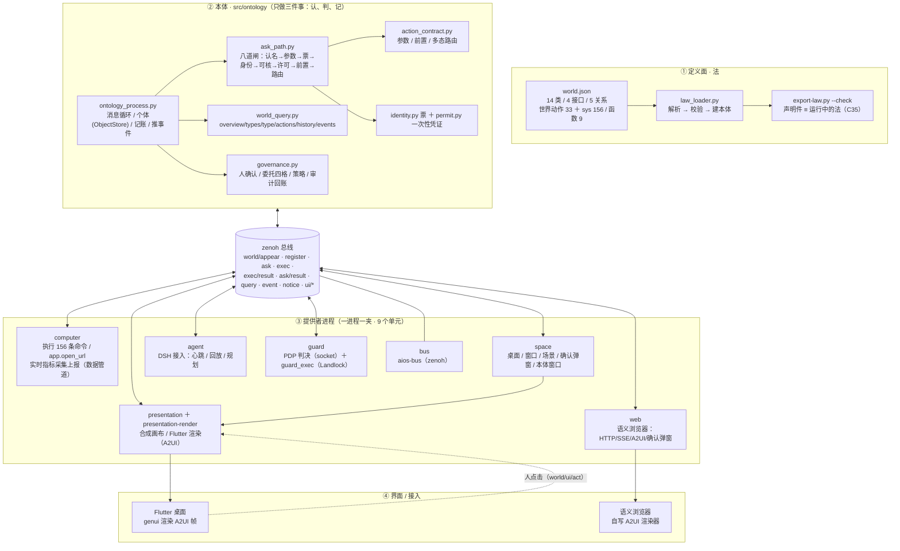
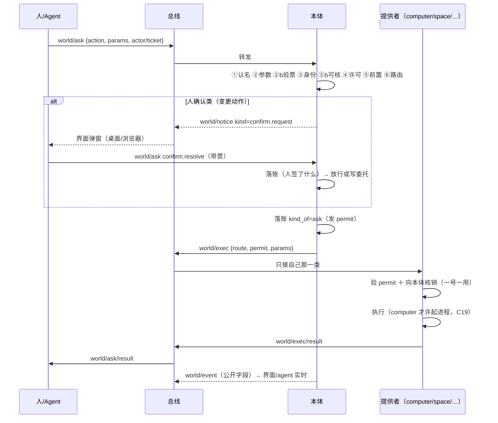
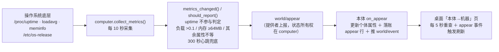
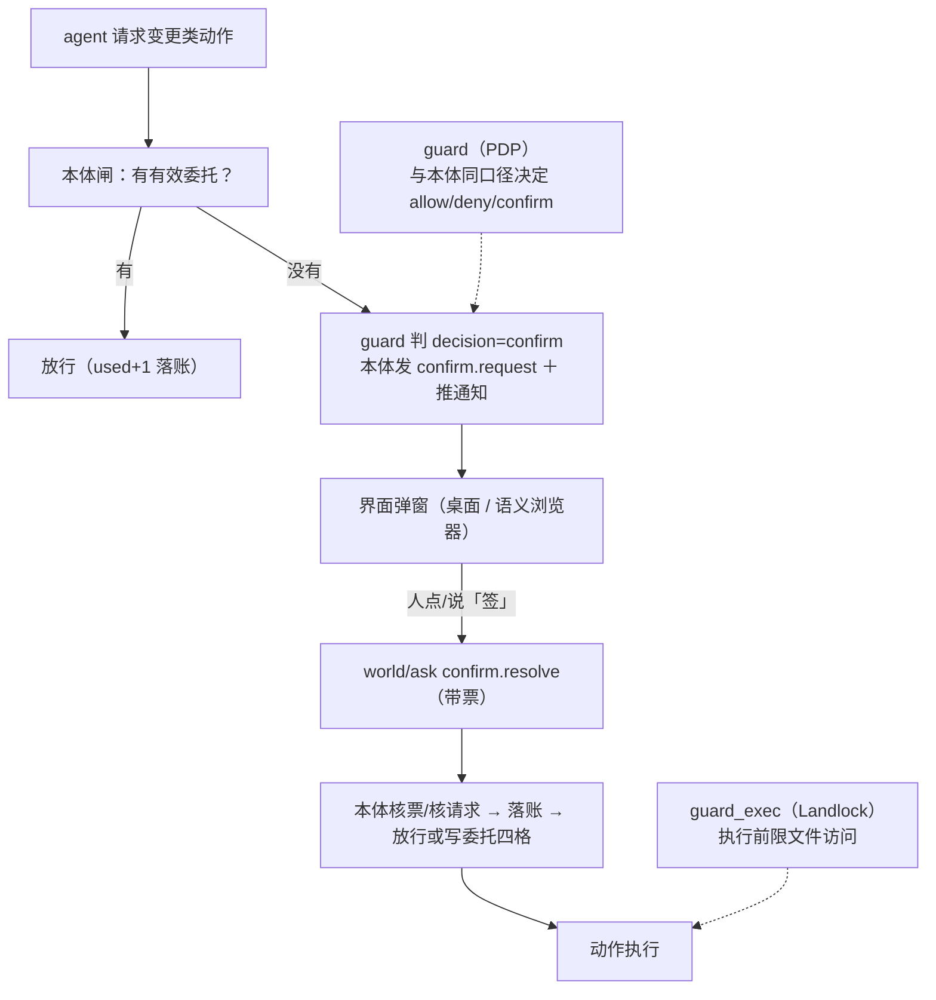

# worldcore 架构图（总览）

> 现取：2026-10-20。类 14 ／ 接口 4 ／ 关系 5 ／ 在册动作 189（sys 156 ＋ 世界 33）／ 函数 9 ／ 判据 66 条 ／ 常驻单元 9 个。
> 图里所有进程都是独立 systemd 单元；所有消息走 zenoh 总线话题 `world/*`。

## 一、四层总览

## 二、数据面（东西存在哪）

| 面 | 路径 | 谁的权威 |
|---|---|---|
| 法（定义） | `src/ontology/world.json` | 唯一权威；`export-law --check` 对账 |
| 个体（A 盒） | `/var/lib/aios/ontology/objects.db`（SQLite） | 本体 ObjectStore |
| 证据（账） | `/var/lib/aios/ontology/ledger.jsonl`（只追加） | 本体（唯一一支笔） |
| 注册表 | `/var/lib/aios/ontology/registry.jsonl` | 提供者注册的动作 |
| 一次性凭证 | `/var/lib/aios/ontology/permits.jsonl` | 本体签发/核销 |
| 事件回放 / 界面 | `/var/lib/aios/{cursors,scenes}` | 空间/浏览器游标、场景文件 |
| 世界文件 | `/var/lib/aios/world/`（worldfs 导出） | 账→文件树的只读镜像 |
| 快照 | `/var/backups/aios/world-snapshots/`（含 forks） | 定时快照进程 |

## 三、一条 `world/ask` 怎么走（八道闸）

## 四、实时数据管道（computer → 本体 → 界面）

## 五、权限 / 人确认 / guard

## 六、运行面（systemd 单元与数据流）

| 单元 | 作用 |
|---|---|
| `aios-bus` | zenoh 总线（7447） |
| `aios-ontology` | 本体：闸/账/事件/查询 |
| `aios-computer` | 执行器＋系统事实上报 |
| `aios-presentation` | 画布合成（A2UI） |
| `aios-presentation-render` | Flutter/genui 渲染器 |
| `aios-space` | 个人空间（桌面/窗口/场景/确认/本体窗口） |
| `aios-agent` | DSH 智能体接入 |
| `aios-guard` | 权限决定（socket `/run/aios/guard.sock`） |
| `aios-web` | 语义浏览器桥（8765） |

> 定时器：看门狗（3 分钟）、世界快照（每小时）、worldfs（15 分钟）等（不属于 9 个常驻进程）。

## 七、设计口径（三句话）

1. **定义与实现分家**：法 `world.json` 是唯一权威，代码只装载它；改法=改声明件。
2. **本体只做三件事**：认（闸）、判（许可/凭证）、记（账）；**不执行、不渲染、不碰机器**。
3. **一进程一夹**：每个进程有独立目录/单元/动作注册/回账；**出向只许 computer**（C19）。

---

*本图与 `docs/CODE-MAP.md` 配套；判据见 `scripts/test/check.py`（66 条，每条自带会红的反例）。*
